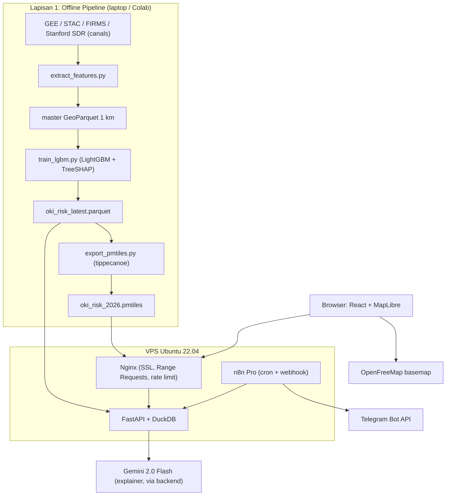

# Architecture Document: Decoupled Pre-computation GIS

## 1. Prinsip Desain Arsitektur

Arsitektur JEJAK API memisahkan proses komputasi spasial berat (*offline batch processing*) dari proses penyajian data antarmuka (*online serving*). Pendekatan ini menjamin keandalan sistem saat demonstrasi, menghilangkan latensi jaringan ke server satelit, dan menjaga penggunaan sumber daya server VPS tetap minimal.

**Aturan keras:** tidak ada pemanggilan Google Earth Engine (`getInfo()` atau sejenisnya) pada jalur request FastAPI maupun peramban.

## 2. Struktur Komponen Sistem

### Lapisan 1: Offline Data & Modeling Pipeline

* **Google Earth Engine & Cloud Storage:** Mengekstrak time-series Sentinel-1 SAR, Sentinel-2, ERA5-Land, CHIRPS, dan NASA FIRMS untuk 55.532 sel grid 1 km² di 6 Episentrum Gambut Nasional (OKI, Pulang Pisau, Ketapang, Merauke, Sorong, Maros).
* **Python ML Pipeline & Benchmark Engine (`benchmark_models.py`):**
  - Mengeksekusi pelatihan progresif model multi-tier: `Baseline_0_LogReg_Weather`, `Baseline_1_LogReg_Weather_History`, `Ablation_LogReg_Full`, dan `Model_Full_LightGBM`.
  - Mengimplementasikan kalibrasi probabilitas via Platt scaling / Isotonic regression (`CalibratedClassifierCV`) untuk memastikan probabilitas keluaran mencerminkan frekuensi empiris kebakaran gambut langka (ECE = 0.0051).
  - Menghitung metrik rare-event: PR-AUC, Recall@top-5%, Precision@k ($k=11, 16$), Brier Score, ECE, dan Reliability Diagram kuantil.
  - Mengekspor artefak komparatif ke berkas JSON lokal (`benchmark_results.json`) dan menyalinnya ke `backend/data/benchmark_results.json`.
  - Menghasilkan `oki_risk_latest.parquet` (55.532 baris) dengan kolom probabilitas terkalibrasi (`risk_score_calibrated`), faktor aksesibilitas ($\min(d_{\text{jalan}}, d_{\text{sungai}})$), dan TreeSHAP local explainer.
* **Tippecanoe Compiler:** Mengonversi data poligon GeoJSON hasil inferensi menjadi berkas ubin vektor ringkas berformat PMTiles multi-skala (`oki_risk_latest.pmtiles`, Zoom 3–14, ~36 MB).

> [!NOTE]
> **Klarifikasi data cuaca & FWI:** FWI (DC dan DMC) bukan representasi risiko tunggal melainkan fitur conditioning pada komponen Hazard. Duff Moisture Code (DMC) dan Drought Code (DC) bukan variabel native ERA5-Land, melainkan dihitung offline dari variabel ERA5-Land (suhu, curah hujan, kelembapan relatif turunan dari dew point, kecepatan angin) mengikuti formulasi Canadian FWI System, lalu dibekukan sebagai fitur tabular.

### Lapisan 2: Backend & Database Layer (VPS Ubuntu 22.04)

* **FastAPI:** Menangani permintaan REST API secara asinkronus (Python 3.11).
* **DuckDB Storage Engine:** Membaca berkas `oki_risk_latest.parquet` secara in-process. Melayani filter Top-k patroli terkalibrasi dengan kendala aksesibilitas jalan/sungai, sorting skor risiko, pencarian multi-kriteria nama desa/KHG, dan agregasi spasial instan dalam <20 milidetik tanpa instalasi basis data relasional berat.
* **Model Benchmark Service:** Menyajikan hasil komparasi saintifik `benchmark_results.json` melalui endpoint `/api/model/benchmark` untuk transparansi dewan juri dan visualisasi kurva keandalan.
* **Live Satellite Ingest Service:** Mengambil data titik api aktif NRT dari satelit VIIRS S-NPP (NASA FIRMS) dengan penyaringan wilayah Indonesia dan sistem fail-safe cache memori lokal.
* **Nginx Web Server:** Menyajikan berkas statis frontend React dan berkas `.pmtiles` dengan dukungan HTTP Byte-Range Requests (hanya mentransfer potongan ubin yang dilihat pengguna di viewport).

### Lapisan 3: Automasi & Peringatan Dini

* **n8n Pro Instance:** Mengeksekusi jadwal cron berkala, meminta data sel berisiko tinggi dari endpoint FastAPI, mengevaluasi persilangan area pantau, dan mendistribusikan pesan peringatan ke saluran Telegram Bot API.
* Arah komunikasi: **sistem -> desa** (push digest). Tidak ada kanal input publik.

### Lapisan 4: Antarmuka Pengguna (Client Browser)

* **React 18 + Vite:** Fondasi aplikasi antarmuka satu halaman yang cepat, modular, dan hemat memori.
* **MapLibre GL JS & PMTiles Protocol:** Mesin pemetaan WebGL yang merender ubin vektor statis `oki_risk_latest.pmtiles` di sisi klien dengan latensi instan melalui HTTP Byte-Range Requests.
* **Hierarki Lapisan (*Layer Stacking Order*):**
  1. `national-epicenter-glow` (Outer radar perimeter blur halo).
  2. `national-epicenter-fill` (Subtle ambient background tint, opacity 0.12–0.18).
  3. `oki-risk-fill` (55.532 sel mikro 1 km² dengan gradien 7 warna risiko, aktif 100% pada zoom 3.0 s/d 16.0).
  4. `oki-risk-line` (Garis kisi sel presisi tinggi).
  5. `national-epicenter-line` (Dashed border batas terluar wilayah pantauan).
  6. `hotspots-points` & `hotspots-pulse` (Titik api aktif NASA FIRMS dengan animasi radar menyala).
* **Desain Antarmuka Multi-Device Responsif:**
  - **Mobile (< 768px):** Search drawer mengambang yang rapi, navigasi wilayah tanpa menutup peta, modal inspeksi bottom-sheet dengan tombol tutup `X` yang nyaman.
  - **Desktop (≥ 768px):** Header search terpusat, sidebar kiri kontrol misi (Basemap, Replay 2019/2023, Mode Drone Live/Thermal, Konversi Lahan), dan sidebar kanan docking inspeksi TreeSHAP.
  - **Basemap Engine:** OpenFreeMap Liberty dengan opsi Dark Matter dan Esri Satellite, bebas royalti tanpa kuota komersial.

## 3. Kontrak API (Ringkasan)

| Endpoint | Metode | Deskripsi | Respons |
|---|---|---|---|
| `/api/patrol/top-k?k=10` | GET | Top-k sel risiko terkalibrasi, `k` 1-100 (disesuaikan 11-16 regu Daops), filter aksesibilitas | `{k, total_cells, results: [CellSummary]}` urut menurun |
| `/api/patrol/top-k/export` | GET | Unduh CSV rute patroli Top-k dengan atribut jarak jalan & sungai | File CSV `oki_patrol_top_k.csv` |
| `/api/cells/{cell_id}/inspect` | GET | Skor + 3 faktor TreeSHAP + narasi saintifik netral | `CellRiskResponse` |
| `/api/model/benchmark` | GET | Perbandingan metrik Baseline 0/1 vs Full Model LightGBM & reliability diagram | `BenchmarkResponse` (PR-AUC, Recall@top-5%, Brier, ECE) |
| `/api/drone/missions` | GET | Misi drone manual VLOS (&le; 120m) sel prioritas Top-k + telemetri GPS + stream RGB/Thermal + deteksi YOLO | `DroneMissionListResponse` |
| `/api/drone/verify` | POST | Pengiriman verifikasi lapangan drone regu darat -> antrean *active learning* retraining queue | `DroneVerificationResponse` |
| `/api/replay?date=YYYY-MM-DD` | GET | Skor historis + titik FIRMS (F3) | GeoJSON ringkas |
| `/api/monitor-areas` | POST/GET | Poligon area pantau admin (F4) | Daftar area + sel risiko |
| `/health` | GET | Liveness probe & status in-process DuckDB | `{status: "ok", database: {...}}` |

## 4. Model Data Inti

| Kolom (`oki_risk_latest.parquet`) | Tipe | Keterangan |
|---|---|---|
| `cell_id` | string | Contoh `OKI_GRID_1042` |
| `lon`, `lat` | float64 | Centroid sel (WGS84 EPSG:4326) |
| `khg_id` | string | Kesatuan Hidrologis Gambut (untuk Spatial Block CV) |
| `issue_date` | date | Tanggal terbit prediksi (`t0`) |
| `risk_score` | float32 | Probabilitas mentah/dasar, `[0.0, 1.0]` |
| `risk_score_calibrated` | float32 | Probabilitas terkalibrasi Platt scaling, `[0.0, 1.0]` |
| `risk_category` | string | Waspada (<40%) / Siaga (40-69%) / Bahaya (&ge;70%) |
| `distance_to_road_m` | float32 | Jarak ke jalan terdekat (OSM) dalam meter |
| `distance_to_waterway_m` | float32 | Jarak ke sungai/kanal terdekat (OSM) dalam meter |
| `access_distance_m` | float32 | Aksesibilitas minimum $\min(d_{\text{jalan}}, d_{\text{sungai}})$ |
| `shap_<feature>` | float32 | Kontribusi TreeSHAP lokal per fitur |

## 5. Matriks Alokasi Sumber Daya Server VPS (Ubuntu 22.04)

* **RAM (8 GB):** Sistem Operasi (~600 MB) + Nginx (~50 MB) + FastAPI Worker (~250 MB) + DuckDB Peak Memory (~1,2 GB). Penggunaan memori stabil di bawah 3 GB (tersisa >5 GB untuk buffer cache OS). DuckDB dibatasi dengan `SET memory_limit='1500MB'`.
* **vCPU (2 Core):** Menangani konkurensi REST API hingga 200+ requests per second karena tidak ada komputasi ML yang dilakukan saat runtime.
* **NVMe Storage (100 GB):** OS & Docker (~15 GB) + Dataset Parquet OKI multi-tahun (~500 MB) + PMTiles (~25 MB). Kapasitas penyimpanan sangat longgar.

## 6. Architectural Decision Records (ringkas)

* **ADR-001:** Tanpa drone otomatis / dok drone (regulasi BVLOS Kemenhub, biaya, skala 1 juta+ ha).
* **ADR-002:** Tanpa portal lapor warga (47+ desa blank spot, UU PDP, risiko kriminalisasi peladang).
* **ADR-003:** PMTiles statis menggantikan GEE live (latensi <100 ms, bebas kegagalan kuota EECU).

Rincian dilacak di [`memory.md`](../memory.md).
