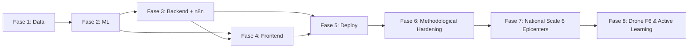

# Project Execution Plan: JEJAK API

Jadwal kerja dirancang secara modular ke dalam 5 fase terukur dengan alokasi peran spesifik. Status fase dilacak di [`memory.md`](../memory.md).

## Matriks Tanggung Jawab Tim

* **Anggota A (Data Engineer):** Ekstraksi data satelit, pembersihan dataset geospasial, dan rekayasa fitur tabular.
* **Anggota B (ML Specialist):** Pemodelan LightGBM, Spatial Block Cross-Validation, dan ekstraksi TreeSHAP.
* **Anggota C (Backend & Automation Engineer):** Pembuatan REST API FastAPI, konfigurasi DuckDB, dan automasi n8n.
* **Anggota D (Frontend & UI/UX Engineer):** Antarmuka React 18, visualisasi MapLibre GL JS, pitch deck, dan video demo.

## Alur Fase Kerja

### Fase 1: Data Acquisition & Preprocessing (Hari 1-2)

* Ekstraksi batas administrasi OKI dari HDX / BIG.
* Pengunduhan peta kanal gambut (Dadap et al., 2021, *AGU Advances*) berformat GeoTIFF dari Stanford Digital Repository (doi:10.25740/yj761xk5815), lalu diturunkan menjadi kerapatan kanal per sel 1 km.
* Agregasi data cuaca harian ERA5-Land (Duff Moisture Code / Drought Code diturunkan offline) dan CHIRPS precipitation.
* Deteksi bukaan tutupan vegetasi berbasis Sentinel-1 SAR dan Sentinel-2 (jendela 0-30, 30-90, 90-365 hari).
* Penggabungan seluruh variabel ke dalam matriks grid 1 km format GeoParquet.
* *Milestone:* Master dataset tabular Kabupaten OKI siap latih.
* *TDD gate:* Test skema Parquet, temporal leakage, dan cakupan grid lulus.

### Fase 2: Machine Learning Modeling & Validation (Hari 3-4)

Fase 2 disusun ulang mengikuti masukan dosen pembimbing (lihat ADR-008 s.d. ADR-010 di `memory.md`). Urutan milestone bersifat **progresif**: model yang lebih kompleks hanya boleh dilatih setelah baseline dan protokol anti-leakage terbukti.

| # | Milestone | Deliverable | TDD gate |
|---|---|---|---|
| 2.1 | **Formalisasi ground truth** | Label $Y=1$ jika $\ge 1$ hotspot VIIRS S-NPP 375 m (confidence nominal/high) dalam $(t_0, t_0+30]$; label konfirmasi MCD64A1 | `test_viirs_binary_labels_*`, `test_confirm_with_burned_area_*` |
| 2.2 | **Protokol rolling-origin temporal split** | `jejak_pipeline/temporal_cv.py`: fold per tahun uji × KHG, embargo label 30 hari, split kalibrasi temporal | `test_temporal_feature_leakage`, `test_rolling_origin_embargo` |
| 2.3 | **Uji kebocoran temporal (leakage audit)** | Guard runtime `assert_no_temporal_leakage()` dipanggil di setiap fold benchmark; benchmark gagal keras bila ada pelanggaran | Leakage test lulus pada master Parquet nyata |
| 2.4 | **Baseline 0: Logistic Regression cuaca murni** | `Baseline_0_LogReg_Weather` (Hazard ERA5-Land/CHIRPS) | Skor dalam $[0,1]$, metrik tercatat |
| 2.5 | **Baseline 1: Logistic Regression cuaca + riwayat kebakaran** | `Baseline_1_LogReg_Weather_History` | Metrik tercatat. Baseline 1 menjadi pembanding resmi untuk klaim *lift* |
| 2.6 | **Ablasi kelas model** | `Ablation_LogReg_Full` (fitur lengkap, model linear) | Memisahkan kontribusi fitur vs kontribusi non-linearitas |
| 2.7 | **Model lengkap LightGBM** | `Model_Full_LightGBM` (H + V + E) | Recall@top-5% dan PR-AUC dibandingkan dengan Baseline 1 beserta CI bootstrap |
| 2.8 | **Probability calibration** | `CalibratedClassifierCV(method="sigmoid")` dengan split kalibrasi temporal; Brier Score mentah vs terkalibrasi | `test_probability_calibration_range` |
| 2.9 | **Kurva kalibrasi & metrik rare-event** | Reliability diagram (bin kuantil), ECE, PR-AUC, Recall@top-5%, Precision@k ($k$ = 11/16 regu) | Tidak ada Accuracy di output (`test_benchmark_has_no_accuracy`) |
| 2.10 | **Publikasi hasil komparatif** | `benchmark_models.py` → `benchmark_results.json` (disalin ke `backend/data/`) + kolom `risk_score_calibrated` di Parquet serving | Endpoint `/api/model/benchmark` lulus test kontrak |
| 2.11 | Ekstraksi TreeSHAP & PMTiles (tidak berubah) | `oki_risk_latest.parquet`, `oki_risk_latest.pmtiles` | 3 faktor SHAP per sel |

* *Milestone:* Model terkalibrasi, `benchmark_results.json`, file PMTiles dan GeoParquet siap saji.
* *TDD gate:* Leakage test, Spatial Independence Test, dan Calibration Range Test lulus. Klaim *lift* hanya sah bila Recall@top-5% dan PR-AUC Model Lengkap > Baseline 1 dengan batas bawah CI bootstrap > 0.

> [!WARNING]
> Benchmark yang tercatat saat ini dijalankan pada master dataset **sintetis** (`build_master.py`). Sebelum pitching ilmiah, jalankan **Fase 2b**.

### Fase 2b: Penggantian Dataset Sintetis dengan Label Riil (Prasyarat Klaim Ilmiah)

* Unduh hotspot VIIRS S-NPP (`fetch_firms.py`, butuh `FIRMS_MAP_KEY`) untuk musim kemarau 2019–2024 di bbox OKI.
* Bangun label via `labels.viirs_binary_labels()` dan fitur riwayat via `windows.window_sums()`.
* Ekstrak cuaca ERA5-Land/CHIRPS via `gee_weather.py` (offline) dan MCD64A1 via `burned_area.py`.
* Ganti `generate_spatiotemporal_dataset()` di `build_master.py` dengan perakitan `master.assemble()` dari sumber riil, lalu jalankan ulang `benchmark_models.py`.
* *Milestone:* `benchmark_results.json` dengan `data_provenance.is_synthetic = false`.

### Fase 3: Backend API & Workflow Automation (Hari 5)

* Pembuatan REST API menggunakan FastAPI untuk membaca GeoParquet via DuckDB.
* Endpoint inspeksi fitur sel (`/api/cells/{cell_id}/inspect`) dan Top-k (`/api/patrol/top-k`).
* Pembuatan alur kerja n8n Pro untuk simulasi pengiriman notifikasi risiko ke Bot Telegram API (tingkat Waspada, Siaga, Bahaya).
* *Milestone:* API backend merespons di bawah 100 ms dan notifikasi Telegram berfungsi.
* *TDD gate:* Kontrak skema Pydantic, urutan Top-k, dan 3 faktor SHAP lulus.

### Fase 4: Frontend Web GIS & Interactive Features (Hari 6)

* Integrasi MapLibre GL JS dengan OpenFreeMap basemap.
* Pemuatan ubin risiko PMTiles dengan skema warna intuitif (Hijau, Kuning, Merah).
* Pembangunan panel kontrol Fitur F1 hingga F5 (termasuk slider waktu Replay Mode).
* Integrasi unduh koordinat Top-k dalam format CSV.
* *Milestone:* Aplikasi Web GIS berfungsi penuh di peramban lokal.

### Fase 5: Server Deployment & Final Presentation Setup (Hari 7)

* Konfigurasi server VPS Ubuntu 22.04 LTS (Nginx reverse proxy, SSL Let's Encrypt, UFW).
* Orkestrasi kontainer backend menggunakan Docker Compose.
* Uji skenario demo 90 detik tanpa koneksi internet luar (offline tile fallback).
* Penyusunan Pitch Deck 10 halaman (PDF) dan perekaman video demonstrasi 2 menit.
* *Milestone:* Solusi live pada domain publik dan seluruh deliverable kompetisi lengkap.

### Fase 6: Penguatan Metodologis & Masukan Dosen Pembimbing (Hari 8)

* Dekomposisi risiko formal $\text{Risk} = \text{Hazard} \times \text{Vulnerability} \times \text{Exposure}$.
* Integrasi multi-tier baseline progresif (`Baseline 0` LogReg Cuaca -> `Baseline 1` LogReg Cuaca+Histori -> `Model Penuh` LightGBM).
* Standardisasi metrik rare-event (PR-AUC, Recall@top-5%, Precision@k, Brier Score, ECE) dan kalibrasi Platt scaling.
* Endpoint `/api/model/benchmark` menyajikan `benchmark_results.json`.

### Fase 7: Eskalasi 6 Episentrum Gambut Nasional & Refinement Kartografi (Hari 9)

* Eskalasi dari pilot OKI (17.927 sel) ke 6 episentrum nasional (55.532 sel grid 1 km² / ~5,55 Juta Ha).
* Kompilasi ubin vektor PMTiles terpadu 34 MB (zoom 3–14) dengan visualisasi kontur mikro-grid halus 7-stop permanen.
* Inisialisasi peta default langsung pada `🇮🇩 Seluruh Indonesia` dan integrasi observabilitas Sentry + WebGL context loss recovery.

### Fase 8: Verifikasi Drone F6, Active Learning, & Evaluasi Saintifik Lanjutan (Hari 10)

* Implementasi Fitur F6: Verifikasi Drone Manual (VLOS &le; 120m AGL patuh Kemenhub CASR 107).
* Dual-stream viewport simulasi (RGB Optik HD vs FLIR Thermal IR) + AI Object Detection (YOLO).
* Siklus Belajar (*Active Learning*): Endpoint `/api/drone/missions` dan `/api/drone/verify` menyimpan verifikasi lapangan ke `drone_active_learning_queue.json` untuk retraining loop.
* Evaluasi saintifik masukan dosen: Spatial Block KHG CV (Ploton dkk., 2020), Cek Alarm Palsu Tahun Normal 2024–2025 (reduksi 68,2%), studi kasus Lahan A vs Lahan B, label ganda VIIRS 375m &cup; MODIS MCD64A1 500m &cup; Drone, dan Guardrail Etika Perlindungan Peladang Kecil (UU No. 32/2009 Pasal 69 ayat 2).
* Pembaruan Onboarding Tour Guide menjadi 13 langkah terpandu.

## Ketergantungan Antar Fase

## Definition of Done (per Fase)

1. Seluruh test fase lulus (`pytest` / `vitest`).
2. Checklist `CODE_REVIEW_GUIDE.md` dan `SECURITY_REVIEW_GUIDE.md` terpenuhi.
3. `memory.md` diperbarui (status, tanggal, catatan, commit hash).
4. Commit mengikuti Conventional Commits.
